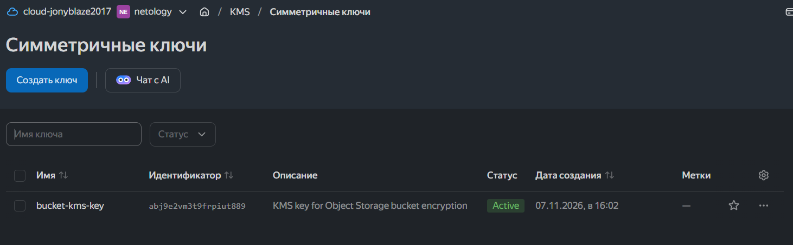
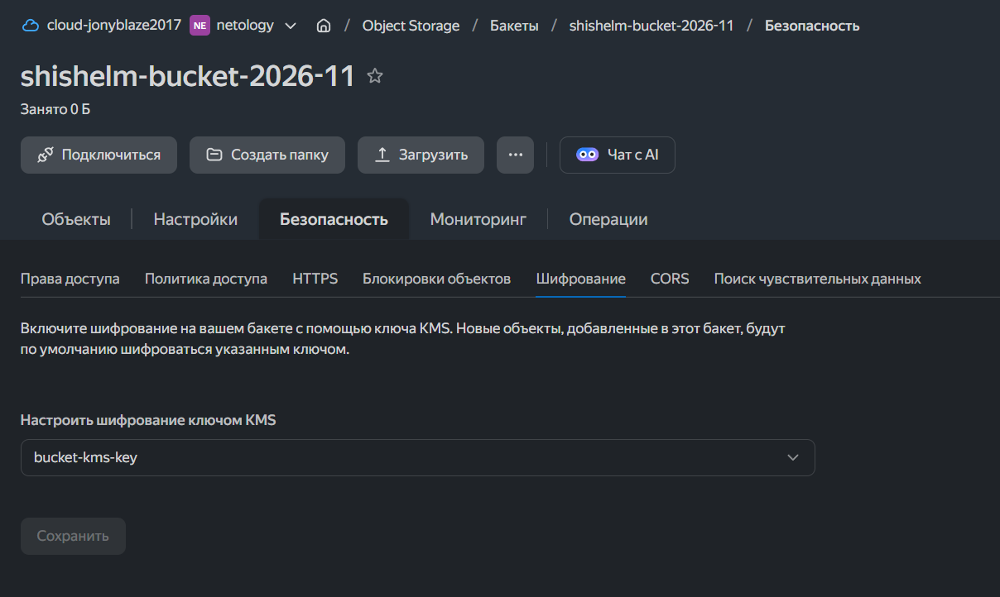
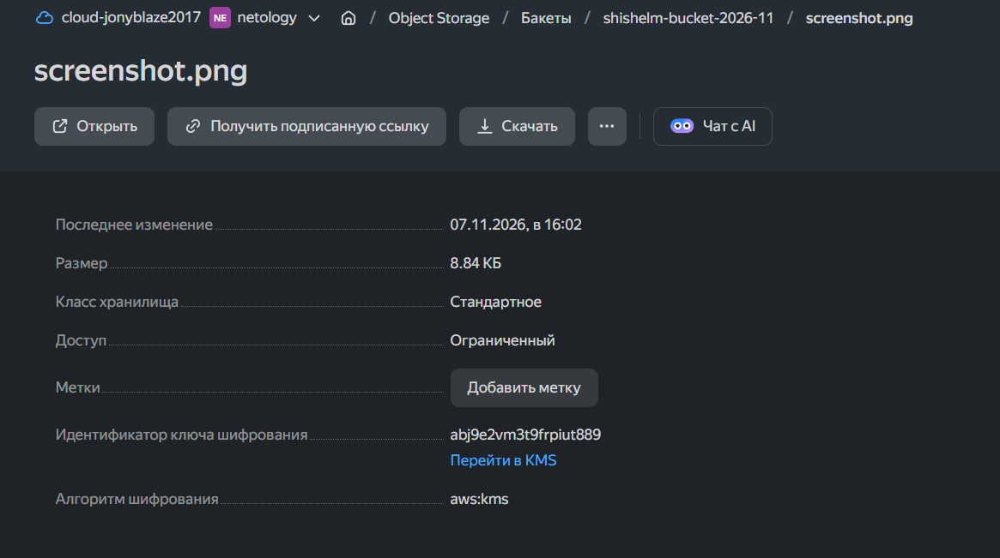

# Домашнее задание к занятию «Безопасность в облачных провайдерах» — Рыбянцев Павел

Задание выполнено на основе инфраструктуры, развернутой в рамках предыдущей домашней работы.
- **Ссылка на предыдущий репозиторий:** [cloud-computing-resources-and-load-balancer](https://github.com/ShishelM/cloud-computing-resources-and-load-balancer)

---

## Задание 1. Yandex Cloud (Шифрование Object Storage с помощью KMS)

### Цель
Обеспечить безопасное хранение конфиденциальных данных в бакете Object Storage, настроив автоматическое шифрование всех загружаемых объектов на стороне сервера (SSE-KMS) с использованием симметричного ключа Yandex Key Management Service (KMS).

### Описание реализации
1. В конфигурации Terraform добавлен ресурс `yandex_kms_symmetric_key.bucket_key` для генерации мастер-ключа с алгоритмом шифрования `AES_256` и годовым периодом ротации.
2. В описание ресурса существующего бакета `yandex_storage_bucket.lamp-bucket` интегрирован блок `server_side_encryption_configuration`. Данное правило принудительно включает автоматическое шифрование (SSE-KMS) для любых новых или перезаписываемых объектов.
3. В целях безопасности бакета отключены анонимный доступ на чтение/просмотр конфигурации, так как зашифрованное хранилище предназначено для безопасного внутреннего использования.

---

1. **Созданный симметричный ключ в KMS:**
   После успешного развертывания проекта проверяем наличие ключа в консоли управления Yandex Cloud в разделе *Key Management Service*.
   

2. **Конфигурация шифрования бакета:**
   Переходим в свойства бакета в раздел "Шифрование". Убеждаемся, что шифрование переведено в статус *Включено* с типом *KMS* и ссылается на наш созданный ключ.
   

3. **Шифрование объектов на стороне сервера:**
   Загруженный через Terraform проверочный объект `screenshot.png` автоматически шифруется на стороне облака. При просмотре свойств объекта внутри бакета отображается статус шифрования *KMS* с соответствующим ID ключа.
   
